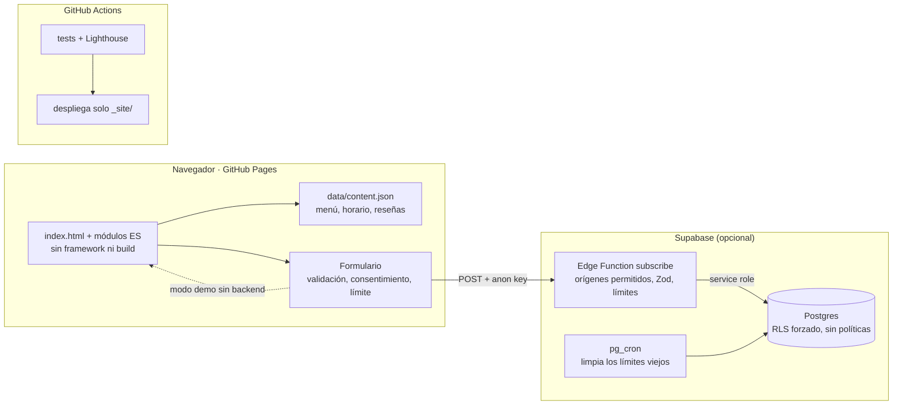

# Brutus Burgers

**Una landing neo-brutalista en HTML, CSS y JavaScript puros, con una suscripción en Supabase protegida y con límite de peticiones.**

[](https://github.com/zSamir015/brutus/actions/workflows/pages.yml)
[](https://github.com/zSamir015/brutus/actions/workflows/test.yml)
[](https://github.com/zSamir015/brutus/actions/workflows/lighthouse.yml)
[](LICENSE)

[English](README.md) | **Español**

Brutus Burgers es la landing page de una hamburguesería ficticia en Costa del Este, Panamá, con estilo neo-brutalista. El frontend es HTML, CSS y módulos de JavaScript, sin frameworks ni herramientas de build. El formulario de suscripción puede usar Supabase de forma opcional, mediante una Edge Function que valida los datos y limita las peticiones. Los textos del sitio están en español porque el negocio está en Panamá.

**[Demo en vivo →](https://zsamir015.github.io/brutus/)** · [Política de seguridad](SECURITY.md)


| Escritorio                                  | Móvil                                |
| ------------------------------------------- | ------------------------------------ |
|  |  |

## Stack técnico

[](#cómo-está-hecho-el-frontend)

HTML5 · Propiedades personalizadas de CSS · Módulos ES de JavaScript · Supabase (Edge Functions, Postgres, pg_cron) · Zod · node --test · Lighthouse CI · GitHub Actions + Pages

## Inicio rápido

```sh
git clone https://github.com/zSamir015/brutus.git && cd brutus
npm run dev   # http://localhost:8000
npm test
```

## Contenido

- [Funciones](#funciones)
- [Arquitectura](#arquitectura)
- [Cómo está hecho el frontend](#cómo-está-hecho-el-frontend)
- [Backend de suscripción](#backend-de-suscripción)
- [Seguridad](#seguridad)
- [Accesibilidad](#accesibilidad)
- [Tests, CI y despliegue](#tests-ci-y-despliegue)
- [Ejecutarlo en local](#ejecutarlo-en-local)
- [Estructura del proyecto](#estructura-del-proyecto)
- [Limitaciones](#limitaciones)
- [Créditos](#créditos)
- [Licencia](#licencia)

## Funciones

- Una hamburguesa en SVG en la portada que se arma capa por capa.
- Menú filtrable por categoría, con una ilustración SVG hecha a mano para cada plato, un favorito destacado y etiquetas como picante o vegetariano.
- "Abierto ahora" o "Cerrado", calculado en la zona horaria del restaurante y no en la del visitante.
- Una fachada ilustrada y un mapa estilizado de Costa del Este.
- Esqueletos de carga mientras llega el contenido, y secciones que aparecen al hacer scroll.
- El formulario del "Club Brutus", con validación, consentimiento explícito, un campo trampa para bots y un límite de intentos en el navegador.
- Detalles de interfaz: una cinta de anuncios, un brillo que recorre los botones, tarjetas que se elevan y se hunden, una casilla animada y grabados de John Leech de 1850 (dominio público) que se enderezan al pasar el ratón.

## Arquitectura



## Cómo está hecho el frontend

No hay framework ni bundler. `index.html` carga directamente unos pocos módulos ES, así que la página pesa pocos kilobytes de código y carga sin ningún paso de build.

- `css/tokens.css` reúne todos los tokens de diseño: colores, espaciado, tipografía y movimiento. `css/styles.css` solo lee esas variables, así que el sistema visual se cambia en un solo sitio.
- El menú, las reseñas, la ubicación y el horario están en `data/content.json`. `js/app.js` lo descarga y construye la página, así que cambiar un precio o el horario no obliga a tocar el HTML.
- Los elementos se crean con `createElement` y se rellenan con `textContent`. Las ilustraciones de `js/art.js` se construyen con `createElementNS`, lo que las mantiene compatibles con una Content Security Policy estricta.
- La validación del formulario (`js/validate.js`) y la lógica del horario (`js/hours.js`) no dependen del DOM, y por eso se pueden probar solo con Node.
- El horario se evalúa en `America/Panama` con `Intl.DateTimeFormat`, así que un visitante en otro país ve si el restaurante está abierto en ese momento.

## Backend de suscripción

El backend es opcional. Sin él, `js/config.js` deja el sitio en modo demo: el formulario valida y confirma, pero no guarda nada.

Con él, el formulario envía los datos a una Edge Function de Supabase, `subscribe`, escrita en TypeScript para Deno:

1. Solo responde a peticiones de los orígenes indicados en el secreto `ALLOWED_ORIGINS`.
2. Aplica límites en tres capas, cada una con una ventana fija de un minuto: 120 suscripciones en total, 5 por IP y 3 por email. El límite global no se puede saltar cambiando de IP, y el límite por email impide usar el formulario para inundar un buzón. Si la comprobación del límite falla, la petición se rechaza.
3. Valida el cuerpo con Zod: un email recortado y en minúsculas de como mucho 254 caracteres, y un `consent` que tiene que ser exactamente `true`.
4. Inserta el email en `subscribers` con la fecha del consentimiento. La inserción ignora duplicados, así que la respuesta nunca revela si una dirección ya estaba suscrita.

En la base de datos, `subscribers` y `rate_limits` tienen Row Level Security forzada y ninguna política, y todos los privilegios están revocados para `anon` y `authenticated`. Las tablas son inaccesibles con la anon key pública; solo la Edge Function, con el rol de servicio, puede escribir. El contador de límites es una función de Postgres (`check_rate_limit`) que solo puede ejecutar el rol de servicio, y un job de `pg_cron` borra cada 15 minutos las entradas de más de una hora para que la tabla no crezca sin fin.

Para activarlo en tu propio proyecto de Supabase:

```sh
supabase db push
supabase secrets set SERVICE_ROLE_KEY=... ALLOWED_ORIGINS=https://zsamir015.github.io
supabase functions deploy subscribe
```

Después añade `SUPABASE_FUNCTIONS_URL` y `SUPABASE_ANON_KEY` como secretos del repositorio (Settings, Secrets and variables, Actions). El workflow de despliegue escribe esos dos valores públicos en `js/config.js`.

## Seguridad

- Content Security Policy estricta, sin `unsafe-inline` para scripts ni estilos.
- Nada de lo que escribe el usuario se inserta como HTML.
- Ningún secreto en el frontend. Lo único que ve el navegador es la URL de las Functions y la anon key, que son públicas por diseño; la clave del rol de servicio solo existe como secreto de Supabase.
- El servidor nunca confía en el cliente: la validación, el consentimiento y los límites se vuelven a aplicar en la Edge Function.

En [SECURITY.md](SECURITY.md) está la lista completa y cómo reportar un problema.

## Accesibilidad

Enlace para saltar al contenido, landmarks semánticos, ARIA donde la semántica nativa no basta, zonas táctiles de al menos 44 px, anuncios `aria-live` para el resultado del formulario y soporte de `prefers-reduced-motion` en todas las animaciones. Lighthouse comprueba la accesibilidad en cada push y pull request.

## Tests, CI y despliegue

```sh
npm test   # node --test, sin dependencias
```

Los tests cubren los módulos puros: limpieza y validación del email, los datos de la suscripción, el límite de intentos en el navegador y la lógica del horario, incluida la zona horaria del restaurante.

Tres workflows de GitHub Actions se encargan del resto. `main` está protegida (pull requests, historial lineal y `lighthouse` obligatorio) y Dependabot mantiene las actions al día.

- **Tests** (`test.yml`), en cada push a `main` y en cada pull request: ejecuta `npm test`.
- **Deploy** (`pages.yml`), en cada push a `main`: ejecuta los tests, genera `_site/` con `scripts/build.sh` (que copia solo los archivos públicos, así que `supabase/`, `test/` y la documentación nunca se publican), escribe `js/config.js` a partir de los secretos del repositorio si existen y publica `_site/` con la acción de despliegue de GitHub Pages. Solo el job de despliegue puede escribir, y solo en Pages, no en el repositorio.
- **Lighthouse** (`lighthouse.yml`), en cada push a `main` y en cada pull request: genera `_site/` y lo audita tres veces. Accesibilidad por debajo de 95, o buenas prácticas o SEO por debajo de 90, hacen fallar la ejecución; rendimiento por debajo de 90 se reporta como aviso.

## Ejecutarlo en local

```sh
npm run dev     # python3 -m http.server 8000 (fetch y los módulos no funcionan desde file://)
npm test
npm run build   # genera _site/ igual que el despliegue
```

## Estructura del proyecto

```
index.html              marcado de la página y Content Security Policy
css/tokens.css          tokens de diseño: colores, espaciado, tipografía, movimiento
css/styles.css          estilos, construidos solo con los tokens
js/app.js               renderizado del contenido, filtro del menú, horario, formulario
js/art.js               ilustraciones SVG de los platos
js/validate.js          validación del formulario y límite de intentos (puro, con tests)
js/hours.js             lógica de abierto o cerrado (pura, con tests)
js/config.js            configuración del modo demo; se reemplaza al desplegar si hay secretos
data/content.json       menú, reseñas, ubicación y horario
supabase/migrations/    tablas, RLS, función de límites y job de limpieza
supabase/functions/     la Edge Function subscribe
scripts/build.sh        copia solo los archivos públicos a _site/
test/                   suites de node --test
```

## Limitaciones

- El sitio solo está en español, a propósito, porque el negocio está en Panamá.
- Los tests automáticos cubren solo la lógica pura. El comportamiento del DOM (el filtro del menú, los estados del formulario) y la Edge Function se prueban a mano; el siguiente paso serían tests de navegador con Playwright y tests en Deno para la función.
- Sin el backend opcional, el formulario funciona en modo demo y no guarda nada.

## Créditos

- Animaciones de interfaz adaptadas de [Uiverse.io](https://uiverse.io/) (autor: 0xnihilism, licencia MIT).
- Ilustraciones de John Leech, _The Comic History of Rome_ (c. 1850), dominio público, a través del [Public Domain Image Archive](https://pdimagearchive.org/).
- Textura de papel derivada de [Texture Labs](https://texturelabs.org/).
- Referencias de diseño de galerías neo-brutalistas en [Dribbble](https://dribbble.com/search/neo-brutalism-food), usadas solo como inspiración.

Los detalles y licencias están en [THIRD_PARTY_NOTICES.md](THIRD_PARTY_NOTICES.md).

## Licencia

El código está bajo [licencia MIT](LICENSE), © 2026 Samir Lorenzo. Los recursos de terceros mantienen sus propias licencias (ver [THIRD_PARTY_NOTICES.md](THIRD_PARTY_NOTICES.md)); en particular, `assets/paper-grain.jpg` no está cubierto por la licencia MIT.

Brutus Burgers es un negocio ficticio creado para este portafolio.
