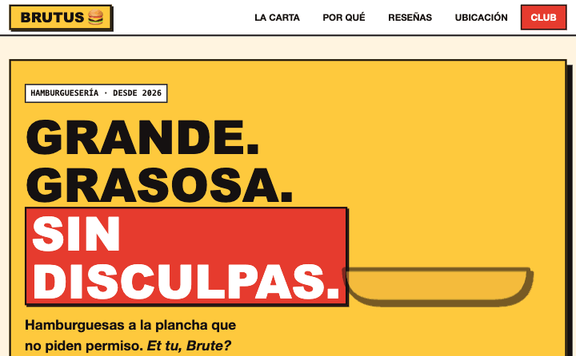
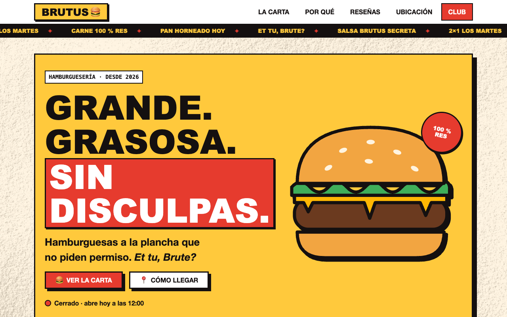
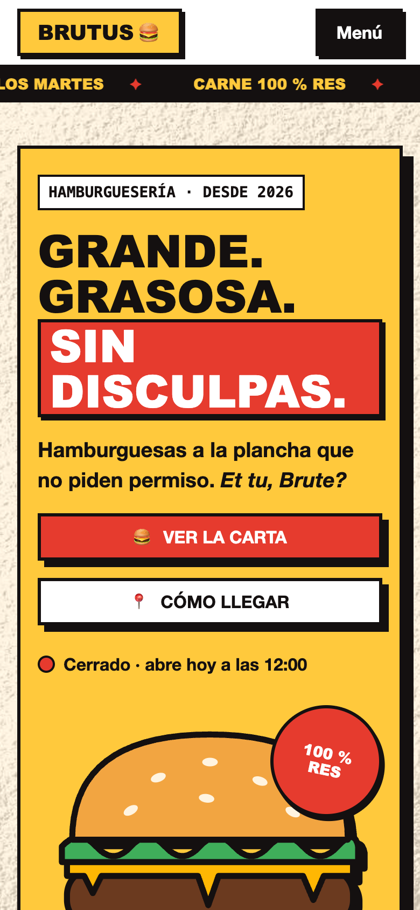

# Brutus Burgers

[](https://github.com/zSamir015/brutus/actions/workflows/pages.yml)
[](https://github.com/zSamir015/brutus/actions/workflows/lighthouse.yml)
[](LICENSE)

English | [Español](README.es.md)

Brutus Burgers is a landing page for a fictional burger restaurant in Costa del Este, Panama, built in a neo-brutalist style. The frontend is plain HTML, CSS and JavaScript modules with no framework and no build tooling. The newsletter signup can optionally be backed by Supabase, through an Edge Function that validates input and rate-limits requests. The site's copy is in Spanish because the business is set in Panama.

Live demo: https://zsamir015.github.io/brutus/



| Desktop                                 | Mobile                                |
| --------------------------------------- | ------------------------------------- |
|  |  |

## Contents

- [Features](#features)
- [How the frontend is built](#how-the-frontend-is-built)
- [Signup backend](#signup-backend)
- [Security](#security)
- [Accessibility](#accessibility)
- [Testing, CI and deployment](#testing-ci-and-deployment)
- [Running it locally](#running-it-locally)
- [Project layout](#project-layout)
- [Limitations](#limitations)
- [Credits](#credits)
- [License](#license)

## Features

- An SVG burger in the hero that assembles layer by layer.
- A menu filterable by category, with a hand-drawn SVG illustration per dish, a highlighted favourite and tags such as spicy or vegetarian.
- "Open now" or "Closed", computed in the restaurant's time zone rather than the visitor's.
- An illustrated storefront and a stylised map of Costa del Este.
- Skeleton placeholders while content loads, and sections that reveal on scroll.
- The "Club Brutus" newsletter form, with validation, explicit consent, a honeypot field for bots and a client-side throttle.
- Small UI details: an announcement ticker, a glare that sweeps across buttons, cards that lift and press, an animated checkbox, and 1850s engravings by John Leech (public domain) that straighten on hover.

## How the frontend is built

There is no framework and no bundler. `index.html` loads a handful of ES modules directly, so the page is a few kilobytes of code and loads without any build step.

- `css/tokens.css` holds every design token: colours, spacing, typography and motion. `css/styles.css` only reads those variables, so the visual system changes in one place.
- The menu, reviews, location and opening hours live in `data/content.json`. `js/app.js` fetches it and builds the page, so changing a price or the hours does not mean editing HTML.
- Elements are created with `createElement` and filled with `textContent`. The dish illustrations in `js/art.js` are built with `createElementNS`, which keeps them compatible with a strict Content Security Policy.
- Form validation (`js/validate.js`) and the opening-hours logic (`js/hours.js`) have no DOM dependencies, which is what makes them testable with Node alone.
- Opening hours are evaluated in `America/Panama` with `Intl.DateTimeFormat`, so a visitor in another country still sees whether the restaurant is open right now.

## Signup backend

The backend is optional. Without it, `js/config.js` keeps the site in demo mode: the form validates and confirms, but nothing is stored.

With it, the form posts to a Supabase Edge Function, `subscribe`, written in TypeScript for Deno:

1. It only answers requests from the origins listed in the `ALLOWED_ORIGINS` secret.
2. It applies rate limits in three layers, each a fixed one-minute window: 120 signups in total, 5 per IP address and 3 per email address. The global limit cannot be bypassed by changing IP, and the per-email limit stops the form from being used to flood one inbox. If the rate-limit check itself fails, the request is rejected.
3. It validates the body with Zod: a trimmed, lower-cased email of at most 254 characters, and `consent` that must be exactly `true`.
4. It upserts the email into `subscribers` with the consent timestamp. The upsert ignores duplicates, so the response never reveals whether an address was already subscribed.

On the database side, `subscribers` and `rate_limits` have Row Level Security forced on and no policies, and all privileges are revoked from `anon` and `authenticated`. The tables are unreachable with the public anon key; only the Edge Function, using the service role, can write. The rate-limit counter is a Postgres function (`check_rate_limit`) that only the service role can execute, and a `pg_cron` job purges entries older than an hour every 15 minutes so the table doesn't grow forever.

To enable it on your own Supabase project:

```sh
supabase db push
supabase secrets set SERVICE_ROLE_KEY=... ALLOWED_ORIGINS=https://zsamir015.github.io
supabase functions deploy subscribe
```

Then add `SUPABASE_FUNCTIONS_URL` and `SUPABASE_ANON_KEY` as repository secrets (Settings, Secrets and variables, Actions). The deploy workflow writes those two public values into `js/config.js`.

## Security

- A strict Content Security Policy with no `unsafe-inline` for scripts or styles.
- No user input is ever inserted as HTML.
- No secrets in the frontend. The only values the browser sees are the Functions URL and the anon key, both public by design; the service role key only exists as a Supabase secret.
- The server never trusts the client: validation, consent and rate limits are all enforced again in the Edge Function.

[SECURITY.md](SECURITY.md) has the full checklist and how to report a problem.

## Accessibility

A skip link, semantic landmarks, ARIA where native semantics are not enough, touch targets of at least 44px, `aria-live` announcements for the form result, and `prefers-reduced-motion` support for every animation. Lighthouse checks accessibility on every push and pull request.

## Testing, CI and deployment

```sh
npm test   # node --test, no dependencies
```

The tests cover the pure modules: email sanitising and validation, the signup payload, the client-side throttle, and the opening-hours logic, including the restaurant's time zone.

Three GitHub Actions workflows run the rest:

- **Tests** (`test.yml`), on every push to `main` and every pull request: runs `npm test`.

- **Deploy** (`pages.yml`), on every push to `main`: runs the tests, builds `_site/` with `scripts/build.sh` (which copies only the public files, so `supabase/`, `test/` and the docs are never published), writes `js/config.js` from the repository secrets if they are set, and publishes `_site/` with GitHub Pages' own deploy action. Only the deploy job can write, and only to Pages, not to the repository.
- **Lighthouse** (`lighthouse.yml`), on every push to `main` and every pull request: builds `_site/` and audits it three times. Accessibility below 95, or best practices or SEO below 90, fails the run; performance below 90 is reported as a warning.

## Running it locally

```sh
npm run dev     # python3 -m http.server 8000 (fetch and modules do not work from file://)
npm test
npm run build   # builds _site/ exactly as the deploy does
```

## Project layout

```
index.html              page markup and the Content Security Policy
css/tokens.css          design tokens: colours, spacing, typography, motion
css/styles.css          styles, built only from the tokens
js/app.js               content rendering, menu filter, opening hours, form
js/art.js               SVG dish illustrations
js/validate.js          form validation and throttle (pure, tested)
js/hours.js             open or closed logic (pure, tested)
js/config.js            demo-mode config; replaced on deploy when secrets exist
data/content.json       menu, reviews, location and opening hours
supabase/migrations/    tables, RLS, rate-limit function and cleanup job
supabase/functions/     the subscribe Edge Function
scripts/build.sh        copies only the public files into _site/
test/                   node --test suites
```

## Limitations

- The site is only in Spanish, on purpose, since the business is set in Panama.
- Automated tests cover the pure logic only. DOM behaviour (the menu filter, form states) and the Edge Function are tested by hand; browser tests with Playwright and Deno tests for the function would be the next step.
- Without the optional backend, the signup form runs in demo mode and stores nothing.

## Credits

- UI animations adapted from [Uiverse.io](https://uiverse.io/) (author: 0xnihilism, MIT license).
- Illustrations by John Leech, _The Comic History of Rome_ (c. 1850), public domain, via the [Public Domain Image Archive](https://pdimagearchive.org/).
- Paper texture derived from [Texture Labs](https://texturelabs.org/).
- Design references from neo-brutalism galleries on [Dribbble](https://dribbble.com/search/neo-brutalism-food), used for inspiration only.

Details and licenses are in [THIRD_PARTY_NOTICES.md](THIRD_PARTY_NOTICES.md).

## License

The code is under the [MIT license](LICENSE), © 2026 Samir Lorenzo. Third-party assets keep their own licenses (see [THIRD_PARTY_NOTICES.md](THIRD_PARTY_NOTICES.md)); in particular, `assets/paper-grain.jpg` is not covered by the MIT license.

Brutus Burgers is a fictional business created for this portfolio.
